# PSP5 REMAKE

**Made by 08Weber**  
**PSP5 REMAKE Fork & Enhancements by medhatk**

I love the PSP, but going back to the XMB after using a PS5 always feels a bit dated. So I built
psp5: a launcher for the PSP that tries to recreate the look and feel of the **PS5 user interface** –
the row of game tiles at the top, the big artwork filling the screen behind them, the clean dark settings
pages – on a 480×272 screen from 2004.

psp5 runs on PSPs with the **ARK-4 or ARK-5** custom firmware (PSP-1000, 2000, 3000 and the PSP Go). You can start it
like any other homebrew, or let it take over as ARK's own launcher so your PSP boots straight into it.

Everything you see is drawn by psp5 itself. No logos, icons, sounds or other assets from Sony are used –
it's my own take on that style.

| | | |
|---|---|---|
| 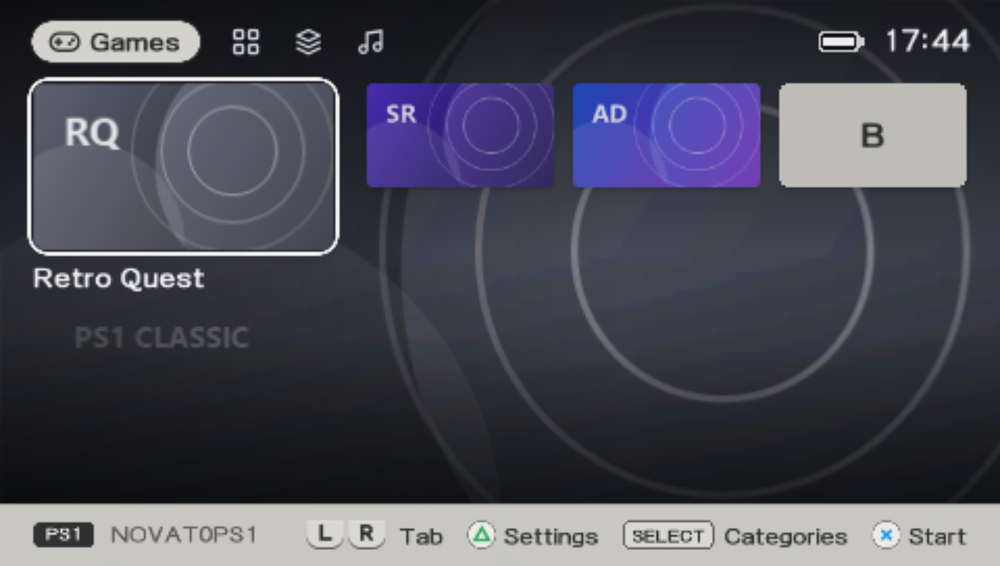<br>*Games* | 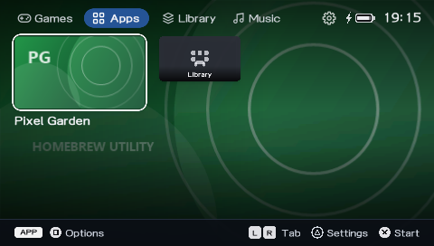<br>*Apps (medhatk)* | 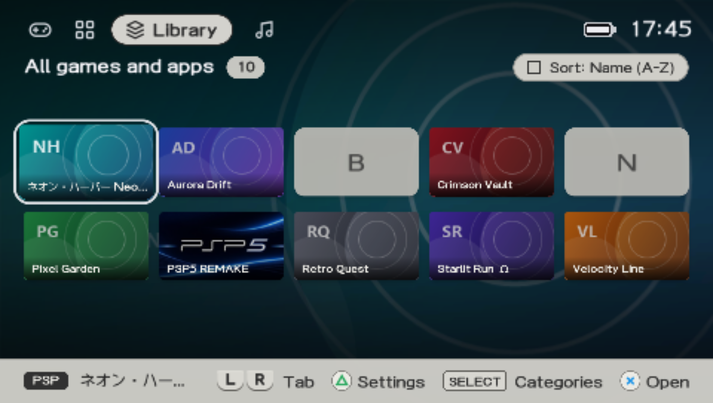<br>*Library* |
| 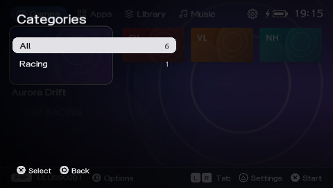<br>*Categories* | 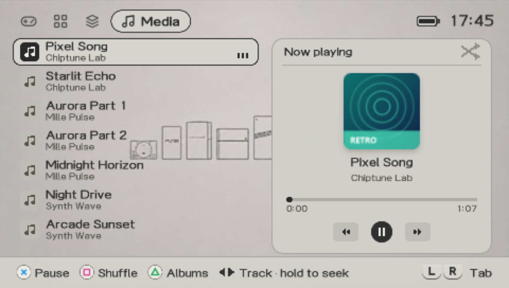<br>*Music — Now playing* | 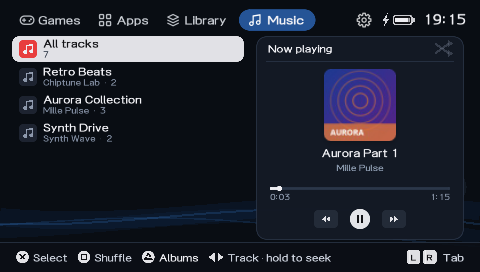<br>*Music — Albums* |
| 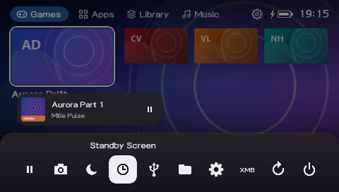<br>*Control Center* | 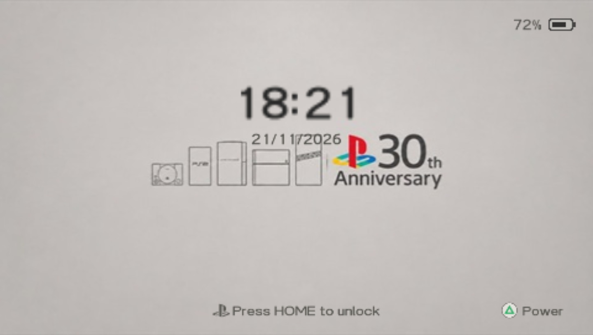<br>*Standby Screen (medhatk)* | 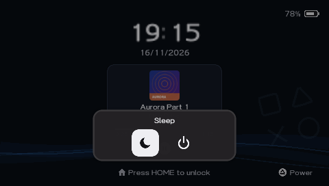<br>*Standby Power menu (medhatk)* |
| 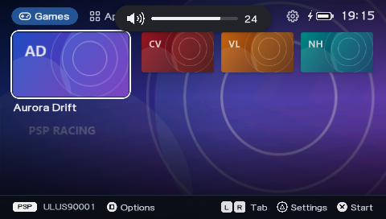<br>*Volume bar* | 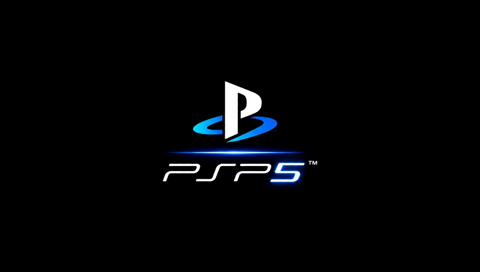<br>*Startup — PSP5™ logo (medhatk)* | 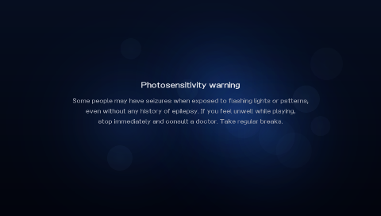<br>*Startup — Health notice* |
| 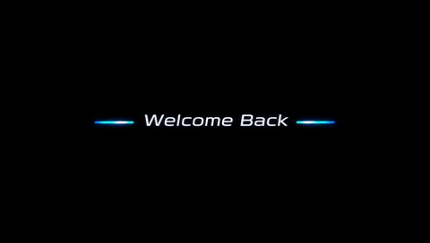<br>*Startup — Welcome Back (medhatk)* | 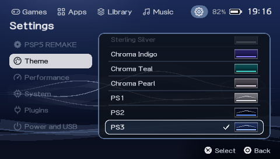<br>*Theme settings* | 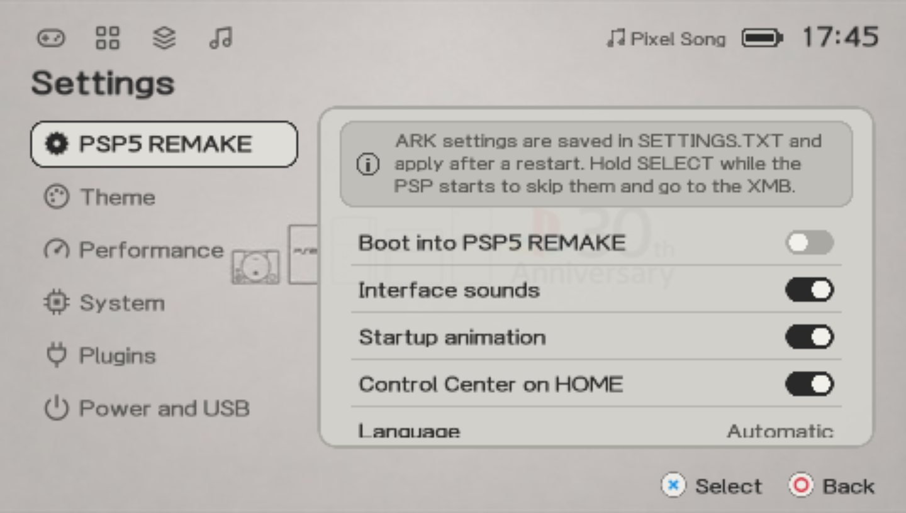<br>*Settings* |
| 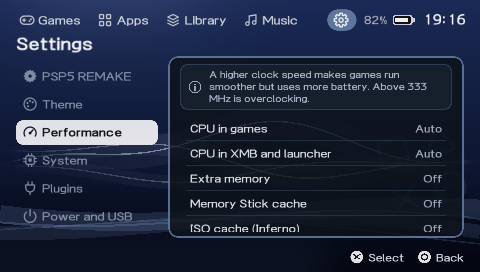<br>*CFW Performance settings* | 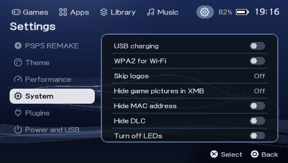<br>*System settings* | 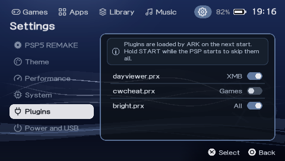<br>*Plugins* |
| 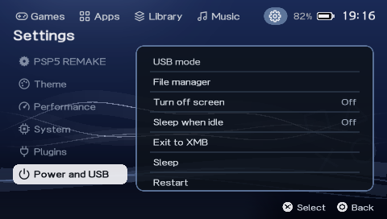<br>*Power and USB* | 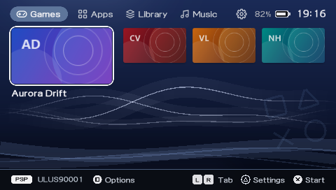<br>*PS3 theme* | 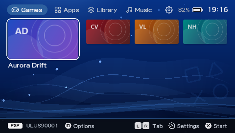<br>*PS4 theme* |
| 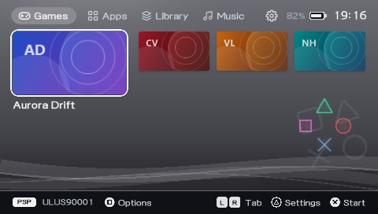<br>*PS1 theme* | | |

## What it does

psp5 starts the way a PS5 does: the psp5 logo on black, a short health notice over deep blue light, then golden
dust that swirls up and a warm spotlight from the top left with "Welcome back" before your games fade in – with a
soft, airy sound underneath. It plays when the PSP starts and when it wakes up from sleep, but not when you come
back from a game. Any button skips it, and you can turn it off in settings. The logo is psp5's own and everything
is drawn and synthesized in code – no borrowed logos or sounds.

The top bar works like the PS5's: **Games**, **Apps**, **Library**, and **Media** are arranged as a unified
top navigation bar – **L** and **R** step directly between them, with the live Now Playing music pill, battery
indicator, and clock visible across screens.

**Games** shows your pinned games and the ones you played most recently in a row. The selected one is large with
a thin light frame around it, and its artwork fades in behind everything. A UMD in the drive shows up first, and it
appears or disappears as soon as you put a disc in or take it out. Press □ on a game to *Pin to front* so it always
stays in the row, and *Move* to put your pinned games in your own order. Want every game in the row?
Turn on *Settings → PSP5 REMAKE → All games on Games screen* (then *Move* works on every game). Press □ on any game
to also view **Information** (file size, folder size calculated in background, DISC ID, version, and last played time)
or manage its **Saved Data**. The last tile opens the **Game Library**: everything you have – PSP games (ISO, CSO, ZSO and
DAX), PSN and PS1 titles and homebrew – in a grid that's easy to scan through. Press □ there to pin a game to the
Games row or to sort by name or by what you added most recently. △ opens Settings from Games, Apps, Media and the Library.

**Apps** gives your homebrew applications and utilities their own dedicated tab alongside Games, keeping your game
lists clean while maintaining the same PS5 card layout, background artwork, and options.

**Media** acts as a unified media hub with three dedicated cards:

- **Music**, like the music player in the XMB: it lists the MP3 and M4A (AAC) files in `ms0:/MUSIC` (and `ef0:/MUSIC` on
  the PSP Go, including sub-folders) with their titles and artists, and keeps playing in the background while you browse
  your games. △ opens the album list. The track that's playing shows up as a little note pill at the top of the other tabs.
  "Now playing" shows the album art – from the file itself or a `cover.jpg` / `folder.jpg` in the album folder – and
  holding ← or → seeks through the track (the longer you hold, the faster it goes).
- **Pictures**: your JPEG and PNG pictures with instant card previews, and ✕ to view them full screen (← → to flip
  through them, and ✕ again to set the picture as your wallpaper).
- **Videos**: a built-in hardware-accelerated **MP4 Video Player**. Standard MP4 video files placed in `VIDEO` are
  decoded directly on the PSP using H.264 (AVC) hardware decoding via the Media Engine (ME) and AAC audio with smooth
  RGB565 display output. It remembers where you left off and offers to resume playback, supports 10-second seeking
  with ← / →, and coordinates audio leases with background music.
  - *Compatibility & constraints:* The player supports standard MP4 container files encoded with H.264 video and AAC audio
    within PSP hardware limits (PSP-compatible resolutions such as 480×272). Standalone PMF video playback in the dedicated
    video player is not supported (PMF remains exclusively for game card animated icon previews, `ICON1.PMF`).
  - *UMD Video movies:* Movies in `ISO/VIDEO` and physical UMD Video discs are detected in the Video section. Selecting
    a UMD Video ISO prompts for confirmation, mounts the ISO through ARK, and smoothly redirects to the XMB where you
    start movie playback from the XMB Video column.

**Search** has an on-screen keyboard on the left and the matching games on the right. They update as you type.

Pressing ✕ (or START) starts the game the same way ARK's own menu does, so updates, patched ISOs and
PS1 games all work. Before a game launches psp5 shuts itself down completely and frees all of its memory,
so the game gets the whole PSP.

**Settings** is laid out like the PS5's settings pages. From there you can adjust **System** settings (screen
brightness, sound volume, Cross/Circle confirm button assignment, USB mode, Date & Time display format, 12-hour/24-hour
clock selection, Daylight Saving offset, and a full System Information page with PSP model, nickname, ARK version, MAC address,
free RAM, and battery health/temperature/voltage), change ARK's CFW options (CPU speed, extra memory, caches,
USB charging and so on), turn plugins on and off, restart, shut down, jump to the XMB or open ARK's recovery menu.

A few other things I cared about:

- **It's quick.** Only the tiles near your selection are loaded, in the background, and all artwork is cached
  as small ready-made textures, so after the first start it opens almost instantly.
- **It has sounds.** Soft ticks when you move around, a swipe between tabs and a little chord when a game
  starts. I synthesize them in code, so there are no audio files – you can listen to them in
  [`docs/sounds/`](docs/sounds), or turn them off in settings.
- **It speaks your language.** psp5 follows the PSP's system language: English, German, French, Spanish,
  Italian, Dutch, Portuguese, Russian and Japanese. Swedish is there too – the PSP itself doesn't offer
  Swedish, so you pick it under *Settings → PSP5 REMAKE → Language*.
- **It has themes.** *Settings → Theme* has the colours of the PS5 console covers (Midnight Black, Cosmic Red,
  Nova Pink, Starlight Blue, Galactic Purple, Volcanic Red, Cobalt Blue, Sterling Silver and the Chroma
  colours), the **PlayStation 30th Anniversary** classic grey theme with its dedicated backdrop and classic
  four-colour PlayStation button symbols, and – like the PS5's own *Appearance* setting – the look of the PS1,
  PS2, PS3 and PS4: the grey console with its button symbols, the dark towers and glowing orbs, the XMB wave and
  the blue PS4 waves.
  Highlight a theme to preview it and press ✕ to use it. You can also turn the game art in the background off,
  so the theme is always visible – or pick a **wallpaper** of your own: any JPEG or PNG in `PICTURE` (the
  XMB's Photo folder) under *Settings → Theme → Wallpaper*.
- **It can preview games like the XMB.** Turn on *Settings → PSP5 REMAKE → Game previews*, and when you rest on a
  game its short video (ICON1.PMF) plays inside the tile and its music (SND0.AT3) plays in the background –
  for games that have them. It's off by default.
- **It keeps the list tidy.** The same game twice (same game ID and title, for example as both ISO and CSO)
  shows up once; turn *Hide duplicates* off in the PSP5 REMAKE settings to see every copy. Square PSP minis icons
  are centred instead of stretched.
- **It shows the volume.** Press the volume buttons anywhere in psp5 and a PS5-style bar slides in at the top,
  with the level and a crossed-out speaker when the sound is off. While the PSP charges, the battery icon fills up
  in a loop next to a little lightning bolt. *Settings → PSP5 REMAKE → Battery* can also show the percentage or the
  time left next to it.
- **It has a file manager**, like ARK's own launcher: *Settings → Power and USB → File manager* (or from Control Center).
  Browse the Memory Stick (`ms0:`) and internal storage (`ef0:` on PSP Go), mark files with □, and copy, move, rename,
  delete or create new folders from the △ menu. Smart conflict resolution lets you Replace, Merge (folders), Skip, or
  Auto-rename conflicting items, with an *Apply to all* option. Copying/moving shows progress and can be cancelled with ○,
  and deleting handles read-only files safely and always confirms first.
- **It has categories.** Put games in folders – `ISO/<folder>/` or `PSP/GAME/<folder>/<game>/` – and press
  SELECT to pick one (for example `ISO/Racing` or `PSP/GAME/GBA`). A `bg.png` in the folder is
  shown behind it in the picker. The active category shows up in the tab name ("Games · Racing"). All folders are
  recognized as categories, including single-game folders. Prefixes `g_` (games) and `s_` (apps) or `CAT_` (from
  plugins like Game Categories Lite) are supported and their prefix is cleaned up in display. Games and Library tabs
  maintain their category filters and selections independently. In a category the Games row shows all of its games;
  "All" counts every game, and SELECT again closes the picker.
- **It has a Control Center.** HOME opens a PS5-style panel with music playback, screenshot, sleep, **Standby Screen**,
  USB, the file manager, settings, the XMB, restart and power off. *Settings → Power and USB* can also turn the
  screen off and put the PSP to sleep after a while without a button press (not while music is playing).
- **It has a Standby Screen.** Pick **Standby Screen** in the Control Center for a theme-styled always-on clock
  with date, battery status and music controls (✕ play/pause, ←/→ previous/next track, △ for Sleep or Shut down).
  It respects your 12-hour or 24-hour time preferences, preserves your screen brightness, pauses auto-sleep while
  open, and pressing **HOME** unlocks back to the menu.
- **It shows the game's logo** (PIC0) under the selected game, and the background art (PIC1) in full resolution.
- **It remembers where you were** – after a game, psp5 opens on the same tab, category and game.
- **It can show your pictures.** Press ✕ on a JPEG or PNG in the file manager to view it (← → for the next one)
  and ✕ again to use it as the wallpaper.
- **It never touches flash0**, and you can always get back to the normal XMB.

## PSP5 REMAKE — Modifications & New Features by medhatk

On top of 08Weber's original psp5 foundation above, the **PSP5 REMAKE** fork includes the following additions and UI updates by **medhatk**:

- **Custom PSP5™ Boot Logo & Welcome Back Screen** (`src/boot.c`, `tools/make_logo.ps1`, `tools/make_welcome.ps1`):
  Pre-rendered **PSP5™** emblem & boot logo (`res/BOOT_SOURCE.png` → `src/logo.h`) and custom **Welcome Back** startup backdrop (`res/WELCOME.JPG` → `src/welcome.h`).
- **Unified PS5 Top Navigation Bar & Custom Outline Icons** (`src/ui.c`, `src/settings.c`, `tools/make_icons.ps1`):
  Reworked the top navigation bar across every screen into a shared pill bar with custom outline icons (`src/icons.h`) cycling via `L` / `R` across **Games**, **Apps**, **Library**, **Music**, and **Settings** (plus the live Now Playing status pill and battery/clock readout).
- **Dedicated Apps Tab & Redesigned Games / Library / Settings Views** (`src/ui.c`, `src/settings.c`):
  - Separated homebrew apps into their own **Apps** tab alongside **Games**.
  - Updated the **Games** and **Apps** rows with hero artwork card framing layered over a calm animated wave backdrop (`ui_draw_calm_backdrop` with a subtle PlayStation watermark) and a unified footer bar showing format badges (`PSP`, `APP`, `PSN`, `PS1`, `UMD`), Disc ID, and button hints.
  - Added header count and quick-action pills (`[SELECT] Categories`, `[□] Sort`) to the **Library** view, plus outline sidebar icons and bottom info callout boxes in **Settings**.
- **Game Icon Fitting & PMF Card Previews** (`src/art.c`, `src/preview.c`, `src/gfx.c`, `src/ui.c`):
  - Automatically trims transparent or symmetric black letterbox/pillarbox borders on game icons, cover-fits wide icons cleanly to the `144×80` card ratio, and centers narrow/square icons over a blurred color-filled backdrop.
  - Crops and rounded-corner-masks animated `ICON1.PMF` video previews (`preview_frame_sub`, `gfx_tex_sub`) to fit seamlessly inside the rounded 16:9 game card.
- **Procedural UI Sound Engine** (`src/sound.c`, `src/sound.h`):
  Restored the lightweight procedural synthesized UI sound engine (sine tones, filtered noise, and envelopes generated at startup with zero external audio assets or embedded FLAC blobs).
- **PlayStation 30th Anniversary Theme & Classic Button Symbols** (`src/theme.c`, `src/theme.h`, `src/anniv_bg.h`, `src/icons.h`, `src/ui.c`, `tools/make_anniv_bg.ps1`, `tools/make_icons.ps1`):
  - Added the **30th Anniversary** theme featuring an embedded classic grey PlayStation 30th Anniversary backdrop (`res/ANNIV30_BG.JPG` → `src/anniv_bg.h`), light grey surfaces, and dark ink accents across cards, dialogs, Settings, File Manager, and Control Center.
  - Added authentic four-colour PlayStation action button symbols (`✕`, `○`, `□`, `△` via `ps_sym_color`), PlayStation emblem texture, and custom `L` / `R` shoulder-button icons across footer hints and menus.
- **Expanded System Settings, Date & Time, and System Information** (`src/system.c`, `src/system.h`, `src/settings.c`, `src/datetime.c`, `src/datetime.h`, `src/config.c`, `src/lang.c`):
  - Added direct **Brightness** and **Volume** controls inside *Settings → System* via the kernel's Impose service (`sceImposeGetParam` / `sceImposeSetParam`).
  - Added **Button assign** (`Cross` / `Circle` confirm button swap) with live UI hint updates and PSP registry persistence (`/CONFIG/SYSTEM/XMB/button_assign`), plus direct **USB mode** access in *Settings → System*.
  - Added an in-card **Date and time** sub-page (`src/datetime.c`) to configure Daylight Saving (`-1 hr`, `As is`, `+1 hr`), Date format (`YYYY-MM-DD`, `DD/MM/YYYY`, `MM/DD/YYYY`), and Time format (`24-hour` / `12-hour`), persisted in `psp5.cfg` and reflected live in the top status bar clock without modifying the PSP's hardware RTC.
  - Added an in-card **System information** sub-page displaying PSP nickname, model, full ARK CFW version, Wi-Fi MAC address, free RAM, and live battery percentage, charging status, voltage, temperature (`°C`), and remaining capacity (`mAh`).
- **Control Center & Standby Screen Enhancements** (`src/ui.c`, `src/main.c`, `src/system.c`, `src/osd.c`, `tools/tests/standby.txt`):
  - Added a **Now playing** mini-card directly inside the Control Center dock alongside the quick actions.
  - Updated the **Standby Screen** to match the active theme or the user's selected custom wallpaper, and placed a compact square **Now playing** music card (cover art, track title/artist, progress bar, and controls) below the large clock.
  - Normalized Standby Screen rendering and display handling to preserve the user's current screen brightness, support 12-hour/24-hour time formats, and render continuously at normal vblank cadence without black-screen transitions.
- **Hardware-Accelerated MP4 Video Player & Media Hub** (`src/video/*`, `src/ui.c`):
  - Integrated a dedicated MP4 player supporting H.264 (AVC) hardware-accelerated video decoding via Media Engine (ME) and AAC audio with RGB565 rendering directly to display buffers.
  - Features resume-playback memory, 10s seeking forward/backward, and automatic audio lease coordination with background music.
  - Built out the unified **Media** hub tab housing Music, Pictures, and Videos.
- **Folder-Based Categories & Single-Game Category Support** (`src/scan.c`, `src/ui.c`):
  - Categories are derived directly from actual folder names across `ISO/` and `PSP/GAME/` on both `ms0:` and `ef0:`.
  - Removed the restriction that hid categories with only one game, so single-game folders appear as full categories.
  - Full support for `g_`, `s_`, and `CAT_` folder prefixes, with independent filtering and cursor memory between Games and Library tabs.
- **File Manager Enhancements & Conflict Handling** (`src/files.c`):
  - Added interactive conflict resolution when copying or moving files/directories: Replace (atomic with backup rollback), Merge (folders), Skip, and Auto-rename (`name (2).ext`), plus an *Apply to all* option.
  - Hardened deletion with read-only file/folder attribute clearing, recursive directory removal, and accurate byte/item progress reporting.
- **Game / App Information & Saved Data Manager** (`src/info.c`, `src/savedata.c`):
  - Added an in-depth **Information** screen (options menu □ → Information) displaying DISC ID, DISC_VERSION, APP_VER, PSP_SYSTEM_VER, background directory size calculation, free space, and last played time.
  - Added a dedicated **Saved Data Manager** (options menu □ → Saved Data) allowing users to inspect save details (timestamp, size, title) and delete saves with safety confirmation.
- **PSP5 REMAKE Branding** (`Makefile`, `src/main.c`, `src/settings.c`, `src/lang.c`, `INSTALL.md`, `tools/make_release.py`):
  Renamed the EBOOT display title (`PSP_EBOOT_TITLE`), module identifier (`PSP5_REMAKE`), Settings category, localized launcher strings, release packaging names, and documentation/fork title to **PSP5 REMAKE**.

## Installing

Everything you need to get psp5 onto your PSP – as a normal app or as ARK's launcher – is in
**[INSTALL.md](INSTALL.md)**. The download is on the [Releases](../../releases) page.

## Buttons

| Button | What it does |
|---|---|
| ← → or the analog stick | move between games (hold to go faster – holding stops at the end, a new press wraps around) |
| ↑ ↓ | move between rows in the Library |
| L / R | switch between Games, Apps, Library, and Media |
| □ | options: pin to front · move (pinned games) · in the Library also sort (name / recently added) · Information & Saved Data · shuffle in Music · delete a letter in Search |
| △ | Settings · albums in Music |
| ✕ in Music | play the selected track (or pause it) |
| ← → in Music | previous / next track · hold to seek |
| ✕ or START | start the selected game / open media |
| any button | skip the startup screen |
| ○ | back |
| SELECT | categories (folders in ISO and PSP/GAME) |
| HOME | Control Center: music, screenshot, sleep, Standby Screen, USB, files, settings, XMB, restart, power off |
| ♪ or L + R + START | take a screenshot (PNG in `PICTURE/PSP5`) |

If something ever goes wrong, hold **SELECT** while the PSP boots – ARK then skips its settings and you land
in the normal XMB. psp5 also looks after itself. If a start doesn't finish (the PSP froze or was switched off
while psp5 was starting), the next start is a *safe start* without the startup screen, music and UMD. If that
doesn't finish either, psp5 sends the PSP to the XMB.

If the HOME menu doesn't respond inside a game, see *Help!* in [INSTALL.md](INSTALL.md).
**L + R + START + ↓** always quits a game. That one is built into ARK.

## Covers

psp5 uses each game's own icon and background automatically. If you'd like your own covers, there's a small
tool for your computer that prepares them – see the covers section in [INSTALL.md](INSTALL.md).

## Status

psp5 runs on the **PSP-1000, PSP-2000, PSP-3000 and PSP Go** with **ARK-4 or ARK-5** – there's a download for
each ARK, on the PSP Go too (see [INSTALL.md](INSTALL.md)), and psp5 adapts the settings to your model and ARK version (for
example, the PSP-1000 has no extra memory or USB charging, and ARK-4 has fewer CPU speeds).

I've been using it on my own **PSP-2000 with ARK-5**, and launching games, artwork and covers all work
there. ARK-4, the PSP-1000/3000, the music player and the new startup screen are newer and I haven't been
able to try them on every combination, so let me know if something behaves oddly. PSP Go support is the
newest and untested on real hardware: started from the internal storage (`ef0:`), psp5 keeps its files there,
and it finds games and music on both the internal storage and a Memory Stick Micro. The PS Vita isn't supported.

## Feedback and issues

If you run into problems or want to share feedback for PSP5 REMAKE, visit the
[GitHub Issues](https://github.com/medhatk/PSP5-REMAKE/issues) page:

- **Report a bug:** Use the **Bug Report** template and include your PSP model, PSP5 REMAKE version, ARK/firmware environment, and steps to reproduce.
- **Request a feature:** Use the **Feature Request** template to describe the problem or use case, your proposed solution, and the expected benefit.
- **Submit compatibility feedback:** Use the **Compatibility Report** template to report how a plugin, homebrew app, or hardware/ARK setup works with PSP5 REMAKE.

Please do not upload copyrighted Sony system files, private keys, or personal data in issue reports.

## Building it yourself

psp5 is written in C and built with the [pspdev](https://github.com/pspdev/pspdev) toolchain plus
[psp-cfw-sdk](https://github.com/pspdev/psp-cfw-sdk), which provides ARK's headers and libraries. With pspdev
installed it's just:

```sh
make
```

On Windows I build it inside WSL – `tools/setup-wsl.sh` installs the toolchain and `tools/build.sh` builds
`dist/PSP/GAME/PSP5/EBOOT.PBP` (`tools/build.sh ark4` or `make ARK=4` builds the ARK-4 version; both also run
on the PSP Go).

## Thanks

- [psp5-authentic](https://github.com/xioonae/psp5-authentic) – reference and inspiration for several new features in PSP5 REMAKE.
- The [ARK-5](https://github.com/PSP-Arkfive) and [ARK-4](https://github.com/PSP-Archive/ARK-4) teams – psp5
  starts games and stores settings the same way their arkMenu does, and uses ARK's libraries through
  psp-cfw-sdk.
- [pspdev](https://github.com/pspdev) for the toolchain, PSPSDK and packages.
- intraFont, libpng, zlib, LZ4 and libcisoread.

## License

GPL-3.0 – see [LICENSE](LICENSE).

psp5 is an unofficial fan project by 08Weber. It is not affiliated with or endorsed by Sony Interactive
Entertainment. "PSP", "PS5" and "PlayStation" are trademarks of Sony Interactive Entertainment Inc.
