# psp5

**Made by Mille Weber**

I love the PSP, but going back to the XMB after using a PS5 always feels a bit dated. So I built
psp5: a launcher for the PSP that tries to recreate the look and feel of the **PS5 user interface** –
the row of game tiles at the top, the big artwork filling the screen behind them, the clean dark settings
pages – on a 480×272 screen from 2004.

psp5 runs on PSPs with the **ARK-4 or ARK-5** custom firmware (PSP-1000, 2000, 3000 and the PSP Go). You can start it
like any other homebrew, or let it take over as ARK's own launcher so your PSP boots straight into it.

Everything you see is drawn by psp5 itself. No logos, icons, sounds or other assets from Sony are used –
it's my own take on that style.

| Settings | Performance |
|---|---|
| 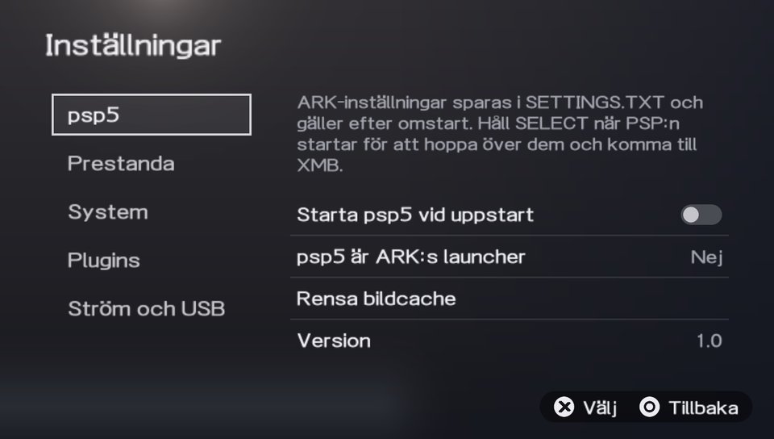 | 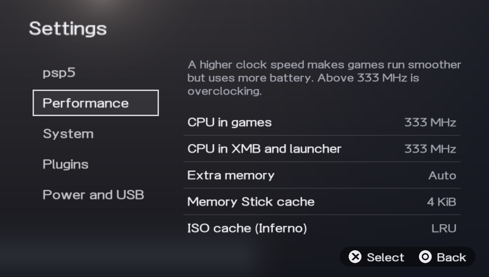 |
| 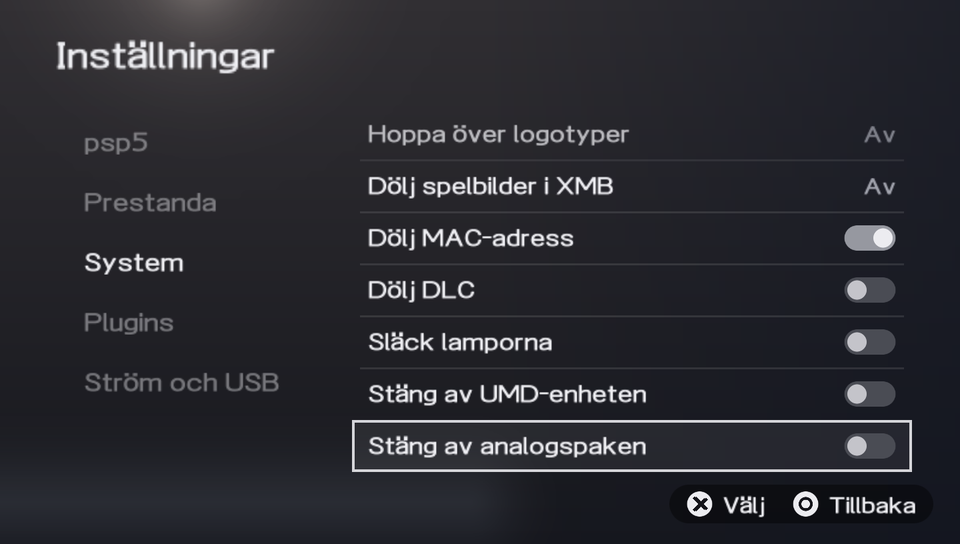 | 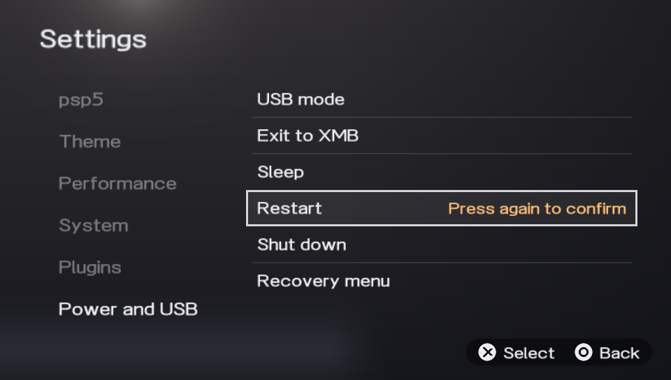 |
| 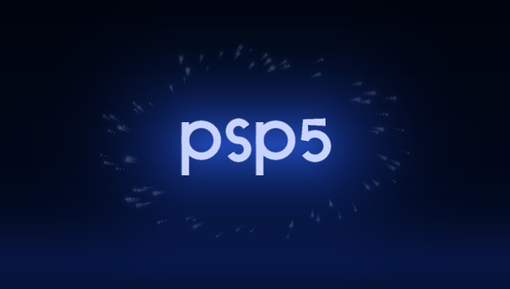 | 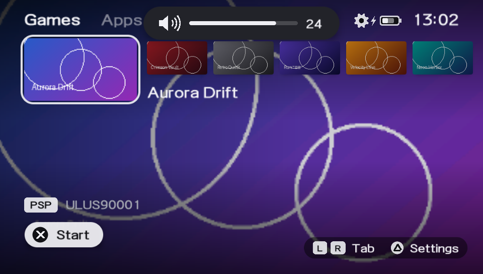 |
| 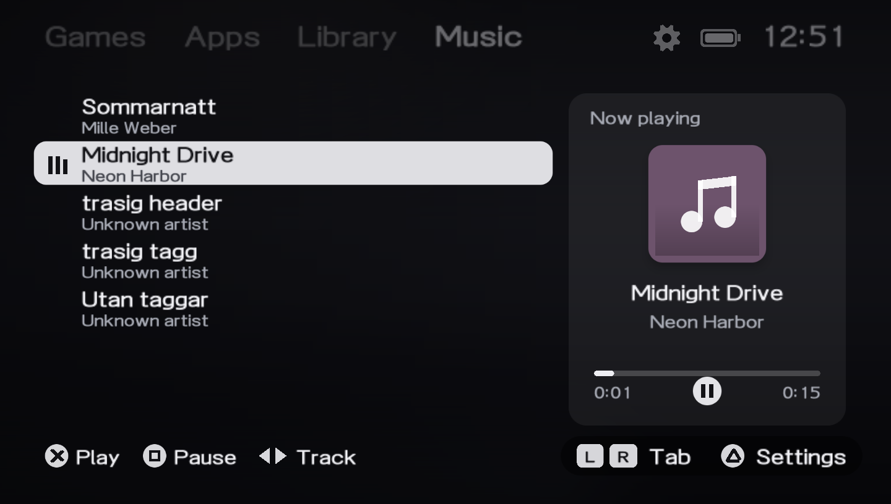 | 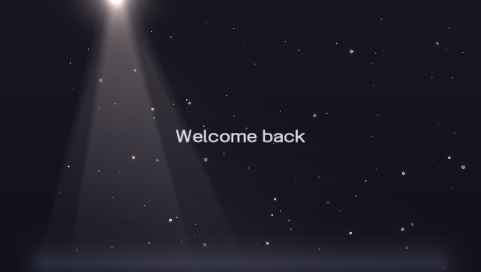 |
| 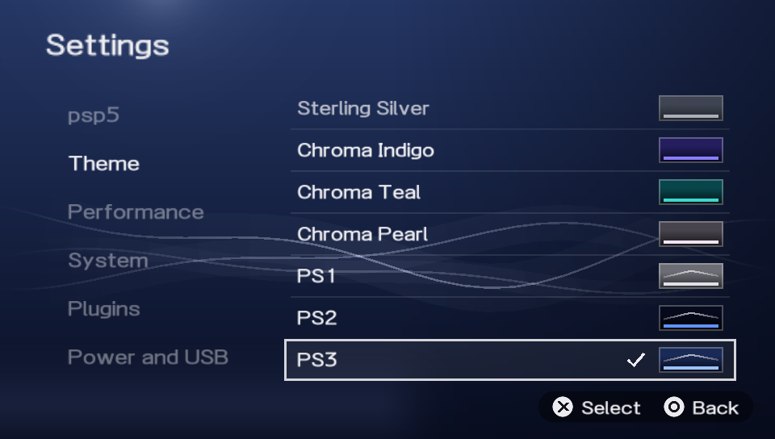 | 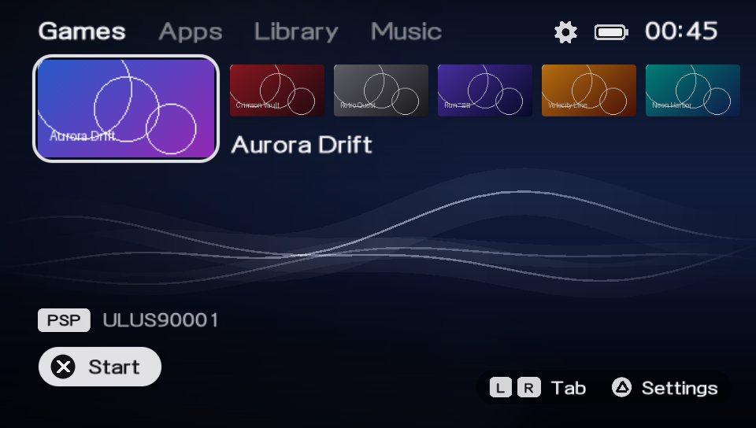 |
| 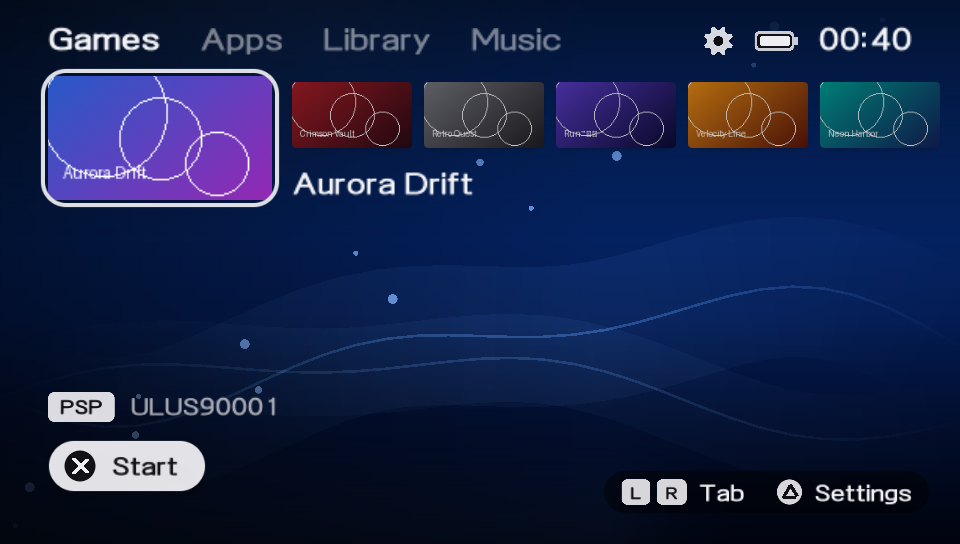 | 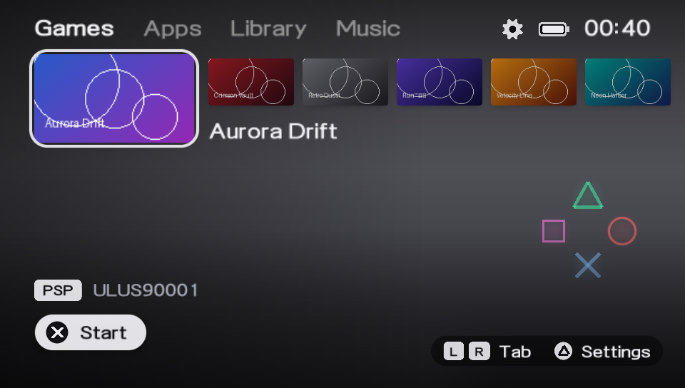 |

## What it does

psp5 starts the way a PS5 does: a small grey logo on black, a short health notice over large, dark blue
out-of-focus circles, then golden dust that swirls up and a warm spotlight from the top left before your games
fade in – with a soft, airy sound underneath. It plays when the PSP starts and when it wakes up from sleep, but not
when you come back from a game. Any button skips it, and you can turn it off in settings. The
logo is psp5's own and everything is drawn and synthesized in code – no borrowed logos or sounds.

Then you get your games in a row along the top. The selected one is large with a thin light
frame around it, and its artwork fades in behind everything. Your PSP games (ISO, CSO, ZSO and DAX) live under
**Games** together with PSN and PS1 titles, and homebrew sits under **Apps** – flip between them with L and R.
Is a homebrew game sitting under Apps? Press □ on it for its options and choose *Move to Games* (and back again), and psp5 remembers it.
A UMD in the drive shows up first under Games, and it appears or disappears as soon as you put a disc in or take it out.
Games and Apps are sorted by name; set *Sort* to *Like the XMB* under Settings → psp5 to get the XMB's order instead
(including an order you set with Homebrew Sorter).
Next to them is the **Library**: everything you have, games and apps together, in a grid that's easy to scan
through. Press □ there to sort by name or by what you added most recently.

The last tab is **Music**, like the music player in the XMB: it lists the MP3 files in `ms0:/MUSIC` (folders
too) with their titles and artists, and keeps playing while you browse your games. The track that's playing
shows up as a little note at the top of the other tabs. "Now playing" shows the album art – from the MP3 itself
or a `cover.jpg` / `folder.jpg` in the album folder – and holding ← or → seeks through the track (the longer you
hold, the faster it goes).

Pressing ✕ (or START) starts the game the same way ARK's own menu does, so updates, patched ISOs and
PS1 games all work. Before a game launches psp5 shuts itself down completely and frees all of its memory,
so the game gets the whole PSP.

Press △ for the settings, laid out like the PS5's settings pages. From there you can change ARK's CFW
options (CPU speed, extra memory, caches, USB charging and so on), turn plugins on and off, connect over
USB, restart, shut down, jump to the XMB or open ARK's recovery menu.

A few other things I cared about:

- **It's quick.** Only the tiles near your selection are loaded, in the background, and all artwork is cached
  as small ready-made textures, so after the first start it opens almost instantly.
- **It has sounds.** Soft ticks when you move around, a swipe between tabs and a little chord when a game
  starts. I synthesize them in code, so there are no audio files – you can listen to them in
  [`docs/sounds/`](docs/sounds), or turn them off in settings.
- **It speaks your language.** psp5 follows the PSP's system language: English, German, French, Spanish,
  Italian, Dutch, Portuguese, Russian and Japanese. Swedish is there too – the PSP itself doesn't offer
  Swedish, so you pick it under *Settings → psp5 → Language*.
- **It has themes.** *Settings → Theme* has the colours of the PS5 console covers (Midnight Black, Cosmic Red,
  Nova Pink, Starlight Blue, Galactic Purple, Volcanic Red, Cobalt Blue, Sterling Silver and the Chroma
  colours), and – like the PS5's own *Appearance* setting – the look of the PS1, PS2, PS3 and PS4: the grey
  console with its button symbols, the dark towers and glowing orbs, the XMB wave and the blue PS4 waves.
  Highlight a theme to preview it and press ✕ to use it. You can also turn the game art in the background off,
  so the theme is always visible – or pick a **wallpaper** of your own: any JPEG or PNG in `PICTURE` (the
  XMB's Photo folder) under *Settings → Theme → Wallpaper*.
- **It can preview games like the XMB.** Turn on *Settings → psp5 → Game previews*, and when you rest on a
  game its short video (ICON1.PMF) plays inside the tile and its music (SND0.AT3) plays in the background –
  for games that have them. It's off by default.
- **It keeps the list tidy.** The same game twice (same game ID and title, for example as both ISO and CSO)
  shows up once; turn *Hide duplicates* off in the psp5 settings to see every copy. Square PSP minis icons
  are centred instead of stretched.
- **It shows the volume.** Press the volume buttons anywhere in psp5 and a PS5-style bar slides in at the top,
  with the level and a crossed-out speaker when the sound is off. While the PSP charges, the battery icon fills up
  in a loop next to a little lightning bolt. *Settings → psp5 → Battery* can also show the percentage or the
  time left next to it.
- **It has a file manager**, like ARK's own launcher: *Settings → Power and USB → File manager*. Browse the
  Memory Stick (and the internal storage on a PSP Go), mark files with □, and copy, move, rename or delete them
  or make a new folder from the △ menu. Copying shows a progress bar and can be cancelled with ○, and deleting
  always asks first.
- **It has categories.** Put games in folders – `ISO/<folder>/` or `PSP/GAME/<folder>/<game>/` – and press
  SELECT to pick one. Start a folder name with `g_` to put everything in it under Games (for example
  `PSP/GAME/g_GBA` for GBA games packed as EBOOTs) or with `s_` for Apps; the prefix isn't shown. A `bg.png` in the
  folder is shown behind it in the picker. The active category shows up in the tab name ("Games · GBA"). A folder
  with a single game (one folder per game) is not a category unless it has one of the prefixes.
- **It has a Control Center.** HOME opens a PS5-style panel with sleep, USB, the file manager, settings, the XMB,
  restart and power off. *Settings → Power and USB* can also turn the screen off and put the PSP to sleep after a
  while without a button press (not while music is playing).
- **It shows the game's logo** (PIC0) under the selected game, and the background art (PIC1) in full resolution.
- **It remembers where you were** – after a game, psp5 opens on the same tab, category and game.
- **It can show your pictures.** Press ✕ on a JPEG or PNG in the file manager to view it (← → for the next one)
  and ✕ again to use it as the wallpaper.
- **It never touches flash0**, and you can always get back to the normal XMB.

## Installing

Everything you need to get psp5 onto your PSP – as a normal app or as ARK's launcher – is in
**[INSTALL.md](INSTALL.md)**. The download is on the [Releases](../../releases) page.

## Buttons

| Button | What it does |
|---|---|
| ← → or the analog stick | move between games (hold to go faster) |
| ↑ ↓ | move between rows in the Library |
| L / R | switch between Games, Apps, Library and Music |
| □ | options (move to Games / Apps) · sort the Library (name / recently added) · shuffle in Music |
| ✕ in Music | play the selected track (or pause it) |
| ← → in Music | previous / next track · hold to seek |
| ✕ or START | start the selected game |
| △ | settings |
| any button | skip the startup screen |
| ○ | back |
| SELECT | categories (folders in ISO and PSP/GAME) |
| HOME | Control Center: sleep, USB, files, settings, XMB, restart, power off |

If something ever goes wrong, hold **SELECT** while the PSP boots – ARK then skips its settings and you land
in the normal XMB. psp5 also looks after itself. If a start doesn't finish (the PSP froze or was switched off
while psp5 was starting), the next start is a *safe start* without the startup screen, music and UMD. If that
doesn't finish either, psp5 sends the PSP to the XMB.

If the HOME menu doesn't respond inside a game, see *Help!* in [INSTALL.md](INSTALL.md).
**L + R + START + ↓** always quits a game. That one is built into ARK.

## Covers

psp5 uses each game's own icon and background automatically. If you'd like your own covers, there's a small
tool for your computer that prepares them – see the covers section in [INSTALL.md](INSTALL.md).

## Status

psp5 runs on the **PSP-1000, PSP-2000, PSP-3000 and PSP Go** with **ARK-4 or ARK-5** – there's a download for
each ARK, on the PSP Go too (see [INSTALL.md](INSTALL.md)), and psp5 adapts the settings to your model and ARK version (for
example, the PSP-1000 has no extra memory or USB charging, and ARK-4 has fewer CPU speeds).

I've been using it on my own **PSP-2000 with ARK-5**, and launching games, artwork and covers all work
there. ARK-4, the PSP-1000/3000, the music player and the new startup screen are newer and I haven't been
able to try them on every combination, so let me know if something behaves oddly. PSP Go support is the
newest and untested on real hardware: started from the internal storage (`ef0:`), psp5 keeps its files there,
and it finds games and music on both the internal storage and a Memory Stick Micro. The PS Vita isn't supported.

## Building it yourself

psp5 is written in C and built with the [pspdev](https://github.com/pspdev/pspdev) toolchain plus
[psp-cfw-sdk](https://github.com/pspdev/psp-cfw-sdk), which provides ARK's headers and libraries. With pspdev
installed it's just:

```sh
make
```

On Windows I build it inside WSL – `tools/setup-wsl.sh` installs the toolchain and `tools/build.sh` builds
`dist/PSP/GAME/PSP5/EBOOT.PBP` (`tools/build.sh ark4` or `make ARK=4` builds the ARK-4 version; both also run
on the PSP Go).

## Thanks

- The [ARK-5](https://github.com/PSP-Arkfive) and [ARK-4](https://github.com/PSP-Archive/ARK-4) teams – psp5
  starts games and stores settings the same way their arkMenu does, and uses ARK's libraries through
  psp-cfw-sdk.
- [pspdev](https://github.com/pspdev) for the toolchain, PSPSDK and packages.
- intraFont, libpng, zlib, LZ4 and libcisoread.

## License

GPL-3.0 – see [LICENSE](LICENSE).

psp5 is an unofficial fan project by Mille Weber. It is not affiliated with or endorsed by Sony Interactive
Entertainment. "PSP", "PS5" and "PlayStation" are trademarks of Sony Interactive Entertainment Inc.
