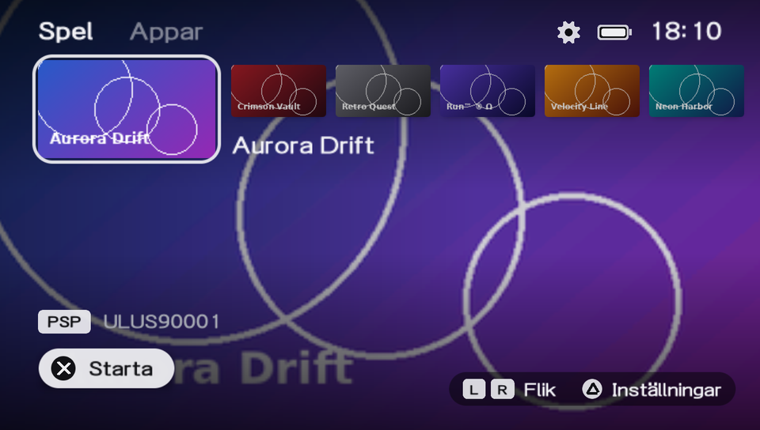

# psp5

A modern, dark game launcher for the PSP running **ARK-5** custom firmware, with a layout inspired by
present-day console home screens. It can run as a normal homebrew app or **replace ARK-5's own
launcher (arkMenu)**, including a full settings screen for the CFW.

All graphics are drawn by psp5 itself – no logos, icons or other artwork from Sony are used.



| Settings | Performance |
|---|---|
|  |  |

> The screenshots use generated test games. The user interface text is currently in **Swedish**.

## Features

- **Home screen** – a row of game cards: the selected game is large with a thin light frame, the rest
  follow as small cards. The selected game's own artwork (PIC1) fills the screen and cross-fades
  when you move. Tabs for **Games** and **Apps** (L/R), clock and battery in the corner.
- **Finds everything** – `ISO`, `CSO` and `ZSO` in `ms0:/ISO` (plus one level of sub-folders) and
  `EBOOT.PBP` homebrew, PSN and PS1 games in `ms0:/PSP/GAME`. Titles and icons are read from
  `PARAM.SFO` / `ICON0.PNG` inside the files, including Japanese titles.
- **Launches games the same way ARK-5 does** – the same `systemctrl` calls as ARK-5's arkMenu,
  including installed updates (`PBOOT.PBP`), patched ISOs (`EBOOT.OLD`) and plain `BOOT.BIN`.
- **Fast and light** – only the cards near the selection are loaded, in a background thread.
  Artwork and the game list are cached as small ready-to-use textures. Everything (threads,
  textures, fonts, GPU) is freed before a game starts.
- **Settings (△)** – modelled on modern console settings pages:
  - CFW settings in ARK's own `SETTINGS.TXT`, written in exactly the same format as arkMenu
    (CPU clock, extra memory, caches, USB charging, logos, regions, …). Unknown lines and comments are kept.
  - Enable/disable plugins in `PLUGINS.TXT`.
  - USB mode, exit to XMB, sleep, restart, shut down and ARK's recovery menu.
  - "Boot into psp5" (ARK's launcher autoboot) and interface sounds on/off.
- **Interface sounds** – soft ticks when moving, a swipe between tabs, chimes for select/back and a
  swelling chord when a game starts. The sounds are synthesized by psp5 at start-up (no audio files, no
  sounds taken from any console) and can be turned off in settings. Preview them in [`docs/sounds/`](docs/sounds).
- **Cover tool for your PC** – `tools/covers.py` prepares card and background images for every game
  on the memory stick, from your own pictures or the games' own artwork.
- **Never touches flash0.**

## Install

See **[INSTALL.md](INSTALL.md)** for step-by-step instructions, both as a normal app and as ARK-5's launcher.

Quick version: download `psp5-*.zip` from [Releases](../../releases) and copy the `PSP` folder to the
root of your memory stick.

## Controls

| Button | Action |
|---|---|
| ← → / analog stick | move (hold to scroll faster) |
| L / R | switch tab (Games / Apps) |
| ✕ or START (○ with the Japanese button setting) | launch |
| △ | settings |
| ○ | back (in settings) |
| HOME | quit to XMB |

## Status

- Developed and tested on a **PSP-2000 with ARK-5**. Game launching, artwork and covers are confirmed
  working on real hardware.
- The settings screen, USB mode and recovery shortcut are new and have so far only been tested in PPSSPP.
- Other models (1000/3000/Street) should work but are untested. PSP Go (`ef0:`) and PS Vita are not supported.

## Building

psp5 is built with the [pspdev](https://github.com/pspdev/pspdev) toolchain and
[psp-cfw-sdk](https://github.com/pspdev/psp-cfw-sdk) (ARK's headers and stub libraries).
Packages used: `psp-cfw-sdk`, `libpng`, `libintrafont`, `zlib` (plus `liblz4` and `libcisoread` from the SDK).

On Linux with pspdev installed:

```sh
make
# result: EBOOT.PBP
```

On Windows the project uses a **WSL1** distro (WSL2 works too, but enables the hypervisor):

```sh
wsl -d pspdev -u root -- bash /mnt/c/path/to/psp5/tools/setup-wsl.sh   # once: toolchain + packages
wsl -d pspdev --exec bash /mnt/c/path/to/psp5/tools/build.sh           # -> dist/PSP/GAME/PSP5/EBOOT.PBP
```

### Testing in PPSSPP

`tools/make_testdata.py` creates fake test games (iso/cso/zso/EBOOT) and `tools/run-ppsspp.ps1` copies
everything to PPSSPP's memory stick and starts it. For automated runs, `tools/build.sh test` builds a
variant with a scripted test mode (`src/testrun.c`) and `tools/ppsspp-test.ps1 -Script tools/tests/settings.txt`
replays button presses and saves screenshots without touching your keyboard.
PPSSPP has no ARK `systemctrl`, so launching games only works on a real PSP.

## Project layout

| Path | Contents |
|---|---|
| `src/main.c` | start-up, main loop, freeing everything before a game starts |
| `src/ui.c` | home screen layout and animations |
| `src/settings.c` | settings screen |
| `src/gfx.c` | small 2D renderer on the PSP GPU (sceGu) + intraFont text |
| `src/loader.c` | background thread that loads artwork near the selection |
| `src/art.c`, `src/image.c` | covers and cache, PNG decoding, scaling, blur, NTX texture files |
| `src/scan.c`, `src/iso.c`, `src/sfo.c` | scanning, ISO/CSO/ZSO reading, PARAM.SFO |
| `src/launch.c` | launching through ARK-5's systemctrl |
| `src/arkcfg.c`, `src/plugins.c` | ARK's `SETTINGS.TXT` and `PLUGINS.TXT` |
| `src/system.c` | USB, power, XMB and recovery |
| `src/sound.c` | synthesized interface sounds and a small audio mixer |
| `tools/` | build, test and cover scripts |
| `docs/README.sv.md` | Swedish developer notes |

## Credits

- [ARK-5](https://github.com/PSP-Arkfive) by the PSP-Arkfive team – psp5 follows arkMenu's launch logic
  and settings format, and uses ARK's libraries through psp-cfw-sdk.
- [pspdev](https://github.com/pspdev) – toolchain, PSPSDK and packages.
- intraFont, libpng, zlib, LZ4 and libcisoread.

## License

GPL-3.0 – see [LICENSE](LICENSE).

psp5 is an unofficial fan project and is not affiliated with or endorsed by Sony Interactive Entertainment.
"PSP" and "PlayStation" are trademarks of Sony Interactive Entertainment Inc.
